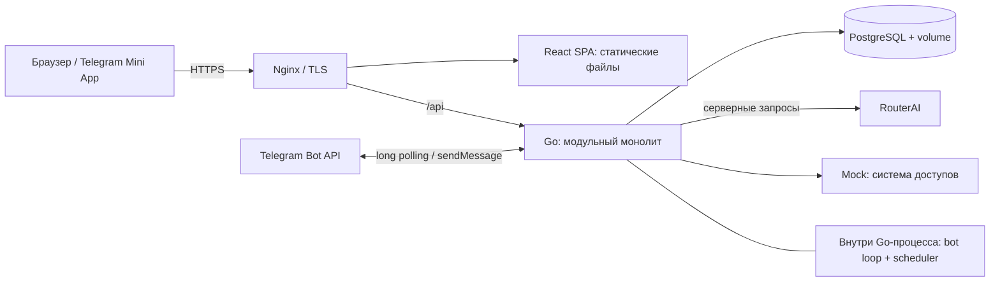

# Архитектура AI-buddy

Документ описывает архитектурное решение и границы MVP. Это не подтверждение завершённого деплоя или live-интеграций. Фактические проверки ведутся отдельно в `docs/implementation-status.md`. Схемы HTTP - `docs/api-contract.md`; критерии приёмки - `specs/`.

## Компоненты и ответственность

React/TypeScript/Vite формирует личный кабинет стажёра, интерфейс наставника, командный обзор руководителя и отдельный экран администратора. Nginx раздаёт сборку SPA и проксирует API в тот же origin. Это упрощает сессионные cookies и проверку origin. В production HTTPS завершается на настроенном reverse proxy; Go и PostgreSQL не должны публиковаться напрямую наружу.

Go API - модульный монолит, а не набор микросервисов. Обработчики HTTP валидируют входы и сессию; бизнес-логика управляет переходами заявок, экзаменами и прогрессом; репозитории работают с PostgreSQL. В том же процессе работают цикл Telegram long polling и scheduler напоминаний. Для MVP предполагается один активный polling-экземпляр. Масштабирование потребует отдельного владения polling, DB-lock/claim для scheduler и разделения фоновых задач.

PostgreSQL хранит пользователей, команды, связи наставников и сессии в реляционных таблицах; каталог знаний и занятий, задачи, попытки, сообщения, заявки и встречи - в индексированных JSONB-записях с внешним ключом владельца. Это гибридная схема MVP, а не полная нормализация всех сущностей из исходного ТЗ. Настройки и административный audit хранятся отдельно. Миграции и seed задают воспроизводимые синтетические данные. Данные должны переживать перезапуск контейнеров за счёт volume.

## Основные потоки

1. Telegram: бот собирает демонстрационный профиль; Mini App передаёт исходный `initData` в `/api/auth/telegram`. Backend проверяет подпись и возраст. Обычный браузер получает `/api/auth/login-link`, ждёт подтверждения ботом и обменивает одноразовый токен через `/api/auth/exchange`.
2. AI: `/api/chat` загружает разрешённый контекст, ищет статьи PostgreSQL, формирует фрагменты и вызывает RouterAI на сервере. Ссылки на разделы строит backend по найденным записям. LLM выбирает разрешённые инструменты; права и аргументы проверяются вне LLM.
3. Доступ: AI предлагает действие; UI показывает ресурс и основание; только `POST /api/requests` с `confirmed:true` создаёт запись. Назначенный наставник принимает решение. Mock-адаптер имитирует выполнение, после чего backend меняет связанную задачу и пересчитывает прогресс. Настоящего доступа к корпоративным ресурсам нет.
4. Обучение: backend выдаёт вопросы без ключей, детерминированно проверяет ответы и сохраняет попытку. AI объясняет тему и ошибки, но не назначает оценку.
5. Напоминания: scheduler выбирает события по времени и настройкам, проверяет сохранённое состояние, отправляет Telegram-сообщение и сохраняет результат. Ошибку доставки нельзя отображать как успех.

## Границы доверия

Роль, пользователь и принадлежность ресурса берутся из серверной сессии/БД. Наставник работает с назначенными стажёрами, руководитель - в пределах команды. Публичный демовыбор роли применяется исключительно к синтетическим данным и не заменяет корпоративную IAM. Администратор авторизуется отдельным паролем; его роль нельзя выбрать в регистрации.

Сессии используют HttpOnly cookie, Secure при HTTPS и SameSite; мутации проверяют origin. Telegram `initDataUnsafe` не считается доказательством личности. Одноразовый браузерный токен ограничен сроком жизни и не может обмениваться повторно.

Секреты настроек Telegram и RouterAI сохраняются зашифрованными серверным ключом; ключ шифрования задаётся отдельно от БД. Ответы admin API содержат только флаги `*_set`; пустое поле секрета сохраняет значение, явный `clear_*` удаляет. Ротация ключа требует плана перешифрования и резервного восстановления. Доступ к RouterAI ограничен разрешённым origin; секреты не попадают в SPA, audit и текст ошибок.

## Эксплуатация и готовность интеграций

Развёрнут отдельный Compose-стек с Go, Nginx/React и PostgreSQL. Существующие сервисы сервера сохраняются; новый hostname добавляется изолированно. Адрес: `https://ai-buddy.85.159.231.99.sslip.io`. TLS и публичная доступность проверены; подробный протокол находится в docs/implementation-status.md.

Telegram-токен и RouterAI API-ключ не предоставлены на момент подготовки документа. Настройка через отдельный admin UI и проверка подключений необходимы до настоящего Telegram/LLM-сценария. Деморежим должен обозначаться в UI и `/api/public/config`. RouterAI-модель выбирается по доступному каталогу и проверяется на tool calling; модель заранее не заявляется рабочей.

Для production нужны HTTPS, сильный admin-пароль и ключ шифрования, сохранность volume/backup, миграции, health checks, таймауты внешних запросов и мониторинг ошибок. Свежий backup восстановлен в отдельную временную БД при проверке развёртывания. Нагрузочная устойчивость и измеренные метрики производительности пока не проверены.

## Расширение после MVP

Адаптеры mock-системы заменяются на IAM/Service Desk/репозитории с идемпотентностью и аудитом; Telegram-вход дополняется SSO и доверенным назначением ролей. Полнотекстовый поиск можно расширить pgvector после оценки retrieval-качества. Scheduler выносится в worker при росте нагрузки. Корпоративные знания подключаются только после определения ACL, политики хранения и допустимого контекста провайдера AI.
